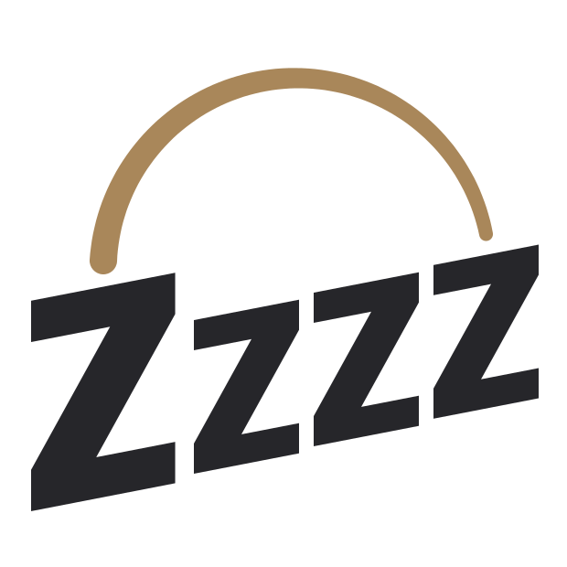

  <picture>
    <source media="(prefers-color-scheme: dark)" srcset="logo-dark.svg">
    
  </picture>

<h1 align="center">Dev Sejenak</h1>

<em>Things built and explored after the sun goes down.</em>

---

Dev Sejenak is a small corner for after-hours tinkering. When the workday ends, this is where the side projects, experiments, and half-finished ideas live, along with the notes written while figuring them out.

### What you'll find here

- **Code from the notes**: examples and demos that go with each write-up
- **Side projects**: small tools and builds, some finished, some still growing
- **Experiments**: quick tries that may or may not go anywhere

Some things here are rough on purpose. Notes and projects keep evolving, so expect updates.
